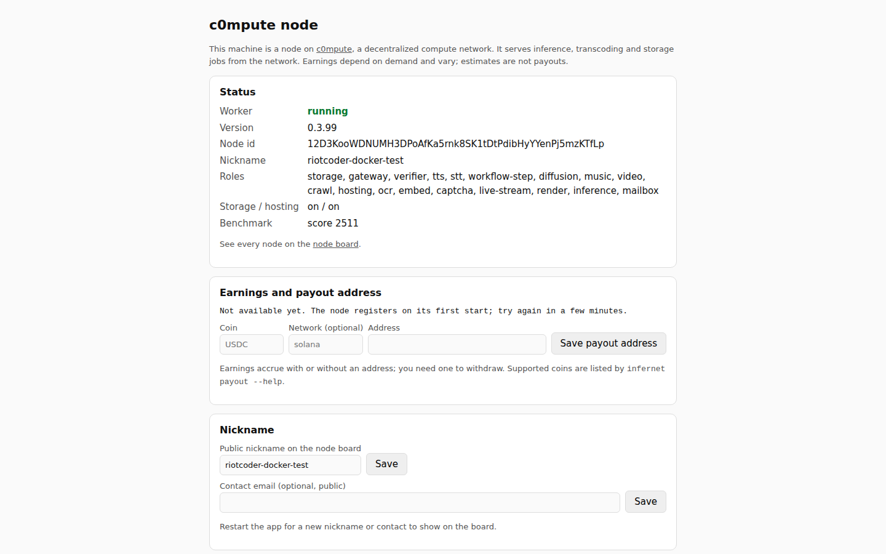

# c0mpute worker image

`ghcr.io/profullstack/c0mpute-worker` runs a [c0mpute](https://c0mpute.com) node in a
container: the signed c0mpute release plus the `coinpay` and `infernet` CLIs,
installed by the same `install.sh` every other node uses, running as a
non-root user (uid 1000). Images are built for `linux/amd64` and `linux/arm64`
after each release by `.github/workflows/worker-image.yml`; tags are the
release version (`0.3.99`) and `latest`.

c0mpute is a decentralized network and paid demand is early: earnings depend
on what the network asks for and vary, and estimates are not payouts. The
worker runs jobs from the network on your machine; read
[docs/node-safety.md](../../docs/node-safety.md) first.

## Run it

```sh
docker run -d --name c0mpute-worker --restart unless-stopped \
  -v c0mpute-data:/data \
  -p 8080:8080 \
  -e C0MPUTE_NAME=yourhandle \
  ghcr.io/profullstack/c0mpute-worker:latest
```



Open `http://<host>:8080` for the status page: worker state, node id, roles,
earnings, and forms for the payout address and nickname. It has no login, so
publish it only on a trusted network (or behind your platform's auth).

Compose:

```yaml
services:
  c0mpute-worker:
    image: ghcr.io/profullstack/c0mpute-worker:latest
    restart: unless-stopped
    volumes:
      - ./data:/data
    ports:
      - "8080:8080"      # status page
      - "46337:46337"    # optional: lets other nodes dial you directly
    environment:
      C0MPUTE_NAME: yourhandle
      # C0MPUTE_PAYOUT_COIN: USDC
      # C0MPUTE_PAYOUT_ADDRESS: <your wallet address>
```

Outbound internet is enough to join; no port forwarding is required.

## Persistent data

Everything the node writes lives under **`/data`** (the container's `$HOME`):
identity keys (`/data/.config/c0mpute`, `/data/.config/infernet`), config
(`/data/.config/c0mpute/config.toml`), the job runtimes and models it downloads
on first start, storage shards and hosted sites (`/data/.local/share/c0mpute`).
Mount a volume there. Without one the node gets a new identity on every
restart and re-downloads its runtimes. A bind mount must be writable by uid
1000 (`chown 1000:1000 ./data`).

The first start downloads speech models and Python packages (a few GB) before
the worker serves; watch `docker logs -f c0mpute-worker`.

## Environment

| Variable | Default | What it does |
| --- | --- | --- |
| `C0MPUTE_NAME` | none | Public nickname on [c0mpute.com/nodes](https://c0mpute.com/nodes). |
| `C0MPUTE_CONTACT` | none | Optional public contact email shown next to the node. |
| `C0MPUTE_REF` | none | Referral handle credited for this node. |
| `C0MPUTE_PAYOUT_COIN` / `C0MPUTE_PAYOUT_ADDRESS` | none | Payout address for inference earnings, set with `infernet payout set` once the node has registered (retried for 10 minutes after start). `C0MPUTE_PAYOUT_NETWORK` picks a network for coins on several chains. Earnings accrue without one; you need it to withdraw. |
| `C0MPUTE_ROLES` | config defaults | Comma-separated roles for `worker start --roles`, e.g. `tts,stt,transcode`. |
| `C0MPUTE_WORKER_ARGS` | none | Extra `worker start` flags, e.g. `--no-hosting --no-storage`. |
| `C0MPUTE_STORAGE` / `C0MPUTE_HOSTING` | on | `0` turns off being a disk provider / holding sites. |
| `C0MPUTE_PRIVATE` | off | `1` serves only your own identities and stays off the public list. |
| `C0MPUTE_INFERENCE_AUTO` | on | `0` stops the worker installing its own CPU LLM runtime. |
| `C0MPUTE_P2P_PORT` | `46337` | libp2p port. Publish it to be directly dialable. |
| `C0MPUTE_P2P_EXTERNAL` | none | Public address to announce when the port is forwarded. |
| `C0MPUTE_UI` / `C0MPUTE_UI_BIND` | on / `0.0.0.0:8080` | Status page on/off and its listen address. |
| `INFERNET_TOKEN` | none | Links the node to your infernetprotocol.com account on first start. |

`C0MPUTE_NO_AUTO_UPDATE=1` is set in the image: the binary does not replace
itself; pull a newer tag instead.

## Commands

Arguments run as `c0mpute` subcommands, and any CLI on the image's PATH runs
directly:

```sh
docker exec c0mpute-worker c0mpute worker status
docker exec c0mpute-worker infernet payout list
docker exec c0mpute-worker infernet payout set USDC <address>
docker run --rm ghcr.io/profullstack/c0mpute-worker:latest --version
```

## GPUs

NVIDIA: run with `--gpus all` (NVIDIA Container Toolkit on the host) so the
worker can detect the card and serve VRAM-sized models from it. GPU use inside
this image is not tested in CI yet; the native installer is the proven path
for GPU nodes.

## Build

```sh
docker build -t c0mpute-worker docker/worker
docker build --build-arg C0MPUTE_VERSION=0.3.99 -t c0mpute-worker docker/worker
```
